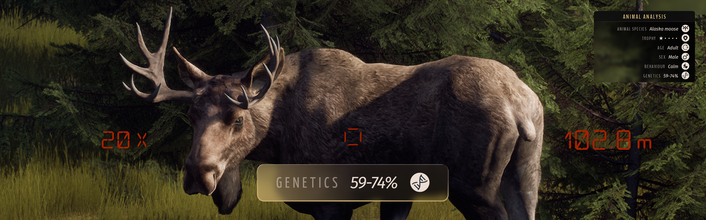
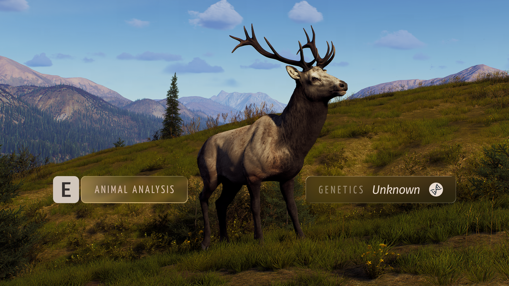
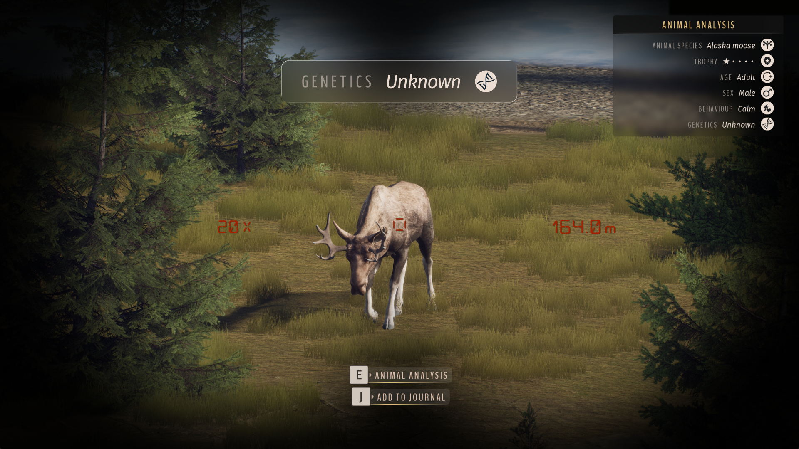
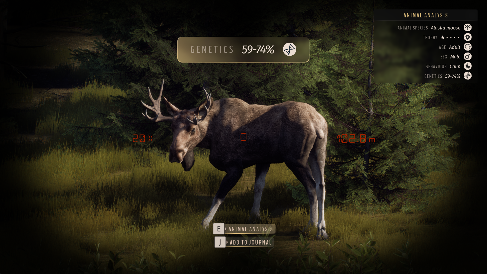
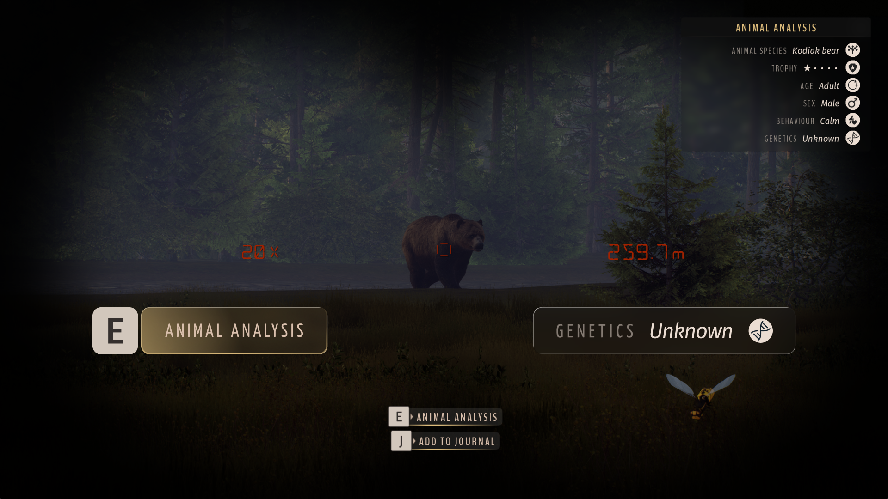

# Genetics Analysis — Way of the Hunter Mod

By Mahpella

Study animals through binoculars in Way of the Hunter to reveal an approximate genetics range that stays saved for each individual.

## Overview

Appearance, age and trophy rating do not tell the whole story when deciding which animals to keep or hunt. Genetics Analysis makes careful observation through binoculars more useful by revealing **an approximate genetic potential range**. Some uncertainty remains, and the result stays with that individual so you can return to it later.

## Download & Install

You can download the mod from my [Website](https://mahpella.com/games/way-of-the-hunter/mods/health-estimate) or [Nexus Mods](https://www.nexusmods.com/wayofthehunter/mods/35).

### Step 1. Create a backup (optional)

If you wish, copy the Saved folder to another location:  
**Win + R → %LOCALAPPDATA%\WayOfTheHunter**

### Step 2. Open the game folder

Close the game. In Steam, browse the local files for Way of the Hunter and open:  
**WayOfTheHunter\Content\Paks**

### Step 3. Install the mod

Extract the archive and copy all **.pak files into the Paks folder**, replacing older versions if necessary.  
Launch the game and load your save.

## How to Use

- Observe a male animal **through binoculars** and bring up its information.
- **Hold E for 1.5 seconds** to complete the analysis and **reveal its Genetics range**.

- Releasing E early lets progress drain; holding it again continues any remaining progress.
- Changing targets or closing binoculars cancels unfinished study. Release E before studying a new target.
- Return to a studied animal to see the same estimate, including after a normal save and restart.

> Females show 0% and do not have a study action.

## Feedback

If you find a bug, have suggestions for improving this mod, or have ideas for new mods, I would love to hear from you.

More useful interface and UX mods at my website: [https://mahpella.com](https://mahpella.com)

If you would like to support my work →  
[Buy Me a Coffee](https://buymeacoffee.com/mahpella) or [PayPal.me](https://paypal.me/bymahpella)

